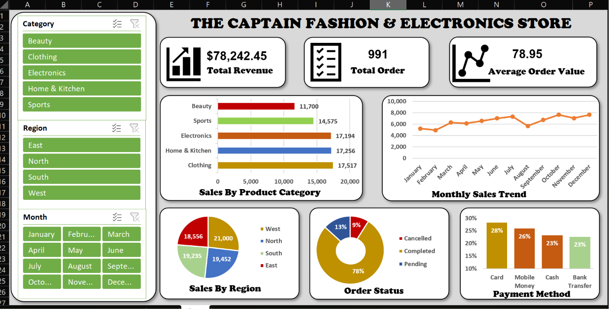

# The Captain Fashion Electronics Store - Retail Sales Analysis
## Project Overview

This project focuses on analyzing retail sales performance for The Captain Fashion & Electronics Store using Microsoft Excel.

The objective is to transform raw sales data into meaningful business insights through data cleaning, analysis, and dashboard visualization.

The dashboard provides insights into revenue, customer orders, product performance, regional sales, payment preferences, and monthly sales trends.

## Tools and Technologies
- Microsoft Excel
- Power Query
- PivotTables
- PivotCharts
- Excel Slicers
- Data Visualization

## Dataset Description
The dataset contains retail transaction records with information such as:
- Order ID
- Order Date
- Customer Name
- Gender
- Product
- Category
- Quantity
- Unit Price
- Total Sales
- Region
- Payment Method
- Order Status

The original dataset contained 1,008 records. After removing duplicate records and rows with missing information, 991 records remained for analysis.

## Project Objectives
The analysis was designed to answer the following business questions:
1. What is the total revenue generated?
1. How many orders were recorded?
1. What is the average order value?
1. Which month recorded the highest sales?
1. Which product generated the highest revenue?
1. Which product category performed best and worst?
1. Which region generated the highest revenue?
1. What is the gender distribution of customers?
1. Which payment method is most frequently used?
1. How many orders were completed, pending, or cancelled?

## Key Performance Indicators (KPIs)
**Total Revenue - $78,242.45**

**Total Orders - 991**

**Average Order Value - 78.95**

## Key Insights
- December recorded the highest monthly sales.
- Air Fryer generated the highest revenue among individual products.
- Clothing was the best-performing product category.
- West recorded the highest regional revenue.
- Card was the most frequently used payment method.
- Completed orders accounted for the largest share of recorded orders.

## Dashboard Features

- Total Revenue KPI
- Total Orders KPI
- Average Order Value KPI
- Sales by Product Category
- Monthly Sales Trend
- Sales by Region
- Order Status Distribution
- Payment Method Analysis

## Recommendations
- Investigate the factors contributing to strong December sales and use the findings to improve seasonal sales planning.
- Maintain adequate stock of high-performing products.
- Develop targeted marketing strategies for lower-performing product categories.
- Investigate regional differences to identify opportunities for sales growth.
- Monitor pending and cancelled orders to improve order completion rates.

## Conclusion

This project demonstrates how Microsoft Excel can be used to clean, analyze, and visualize retail sales data.

Through Power Query, PivotTables, PivotCharts, and dashboard design, raw transaction records were transformed into meaningful insights that can support better business decisions.

**Author:** Suarah Sodeeq Olamilekan

**Project:** Retail Sales Performance Analysis

**Tools:** Microsoft Excel | Power Query | PivotTables | PivotCharts
